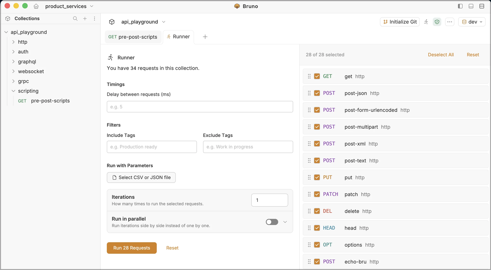
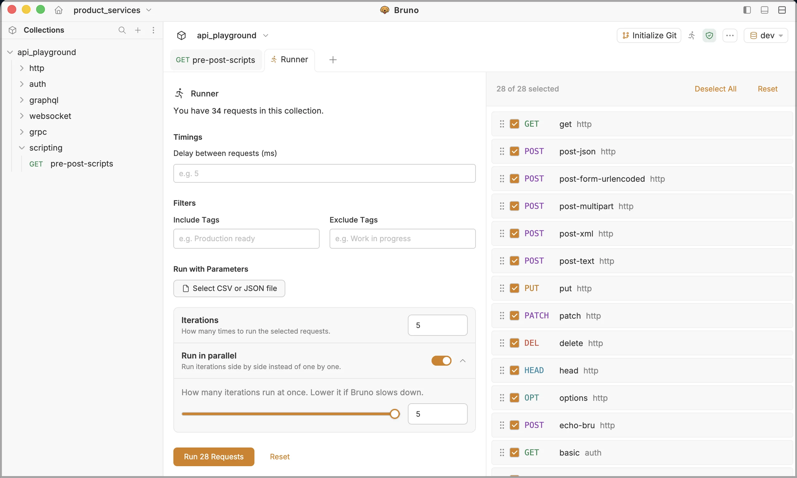
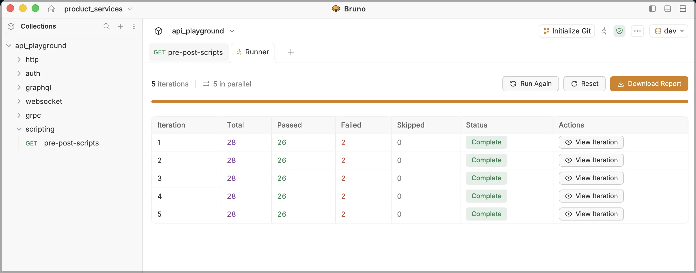

Running a Bruno collection lets you exercise and test an API. You can run collections from the app (**Collection Runner**) or from the command line (**Bruno CLI**).

### Collection Runner

The built-in Collection Runner supports **unlimited** runs, including high iteration counts in both serial and parallel mode.

1. **Open the Collection Runner** using either method:
   - In the sidebar, click **`···`** next to your collection, then select **Run**.
   
   - Or click the **Collection Runner** icon in the top bar.
   

2. **Configure the run** (optional):
   - Set a **delay** between requests
   - Filter with **Include Tags** / **Exclude Tags**
   - Attach a CSV or JSON file under **Run with Parameters** for [data-driven testing](/testing/automate-test/data-driven-testing)
   - Set **Iterations** (how many times to run the selected requests)
   - Select or reorder requests in the right-hand list

3. Optionally turn on **Run in parallel** so iterations run side by side instead of one by one. Expand the parallel settings to set how many iterations run at once.

<Info>
  The concurrency value is the maximum number of iterations running in parallel at any given time. For example, if you have 1,000 iterations and set this to 100, up to 100 will run simultaneously. Whenever one iteration finishes, another starts in its place, keeping up to 100 running until all iterations are complete.

  Running more iterations in parallel may slow down your system. Lower this value if you experience performance issues.
</Info>

4. Click **Run** (the button shows how many requests are selected, for example **Run 28 Requests**).

When the run finishes, the results view lists each iteration with totals for passed, failed, and skipped requests. Open **View Iteration** for details, or download a report when available.

<Warning>
  The Collection Runner does not include gRPC and WebSocket requests. Only HTTP requests will be executed when running a collection.
</Warning>

<Note>
  **Data-driven testing** (running a collection with a **CSV** or **JSON** data file) and **Run in parallel** are available in [Bruno Pro](https://www.usebruno.com/pricing) and [Bruno Ultimate](https://www.usebruno.com/pricing).
</Note>

### Performance tips for large runs

- Prefer a lower parallel concurrency when iterating thousands of times or when responses are large.
- Large response bodies are handled without rendering every payload in the UI at once, so high iteration counts and bigger payloads are less likely to freeze the app.
- For CI or very large data files, use the [Bruno CLI](/bru-cli/overview) with `--parallel` and a data file path.

### Automating Runs in CI/CD

1. **Use the Bruno CLI** to run collections from scripts and pipelines (no GUI required).

2. **Follow the CLI docs** to install the CLI, run a collection, and wire it into your CI/CD jobs: [Bruno CLI <strong>↗</strong>](https://docs.usebruno.com/bru-cli/overview)
