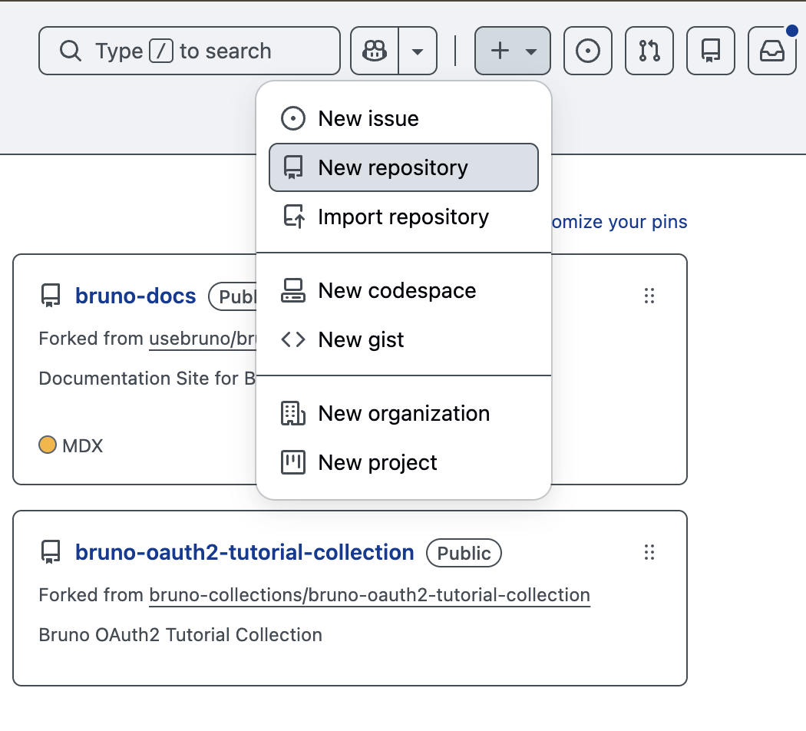
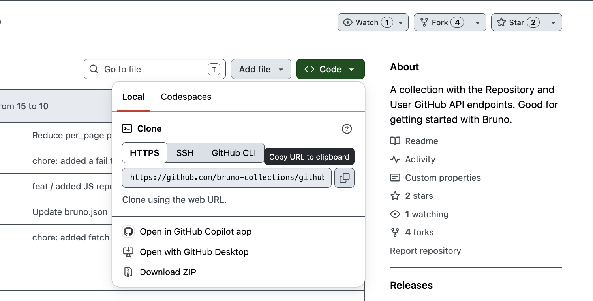
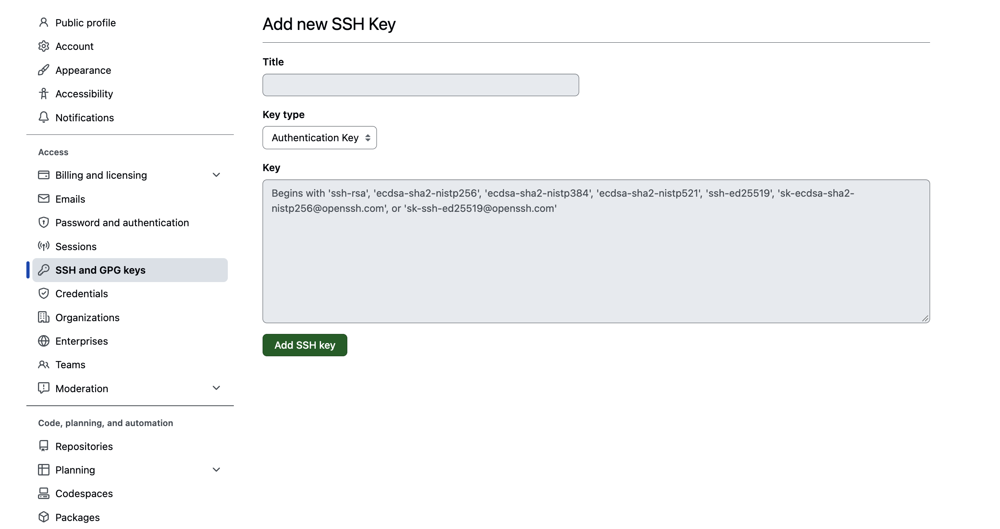
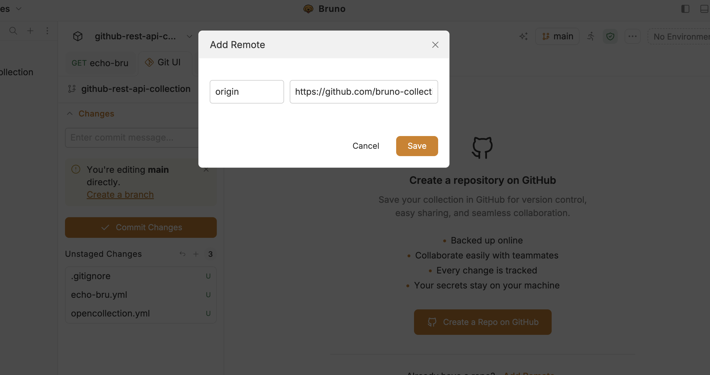
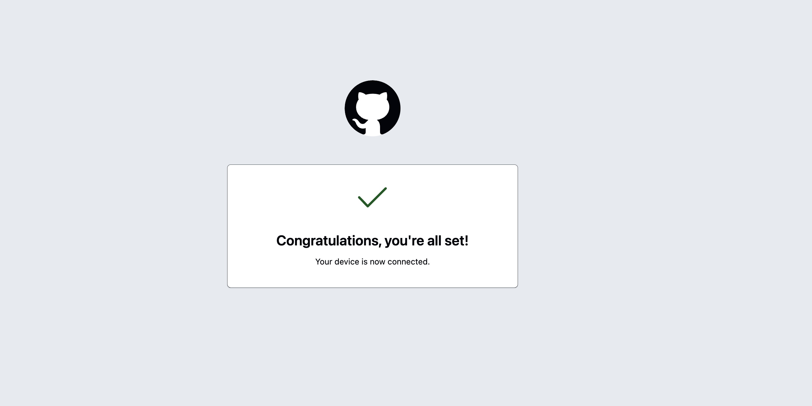
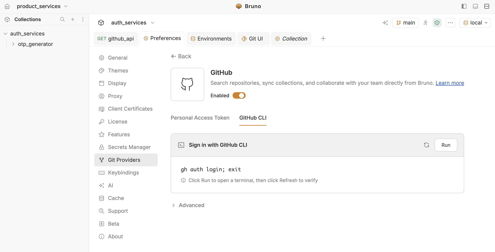
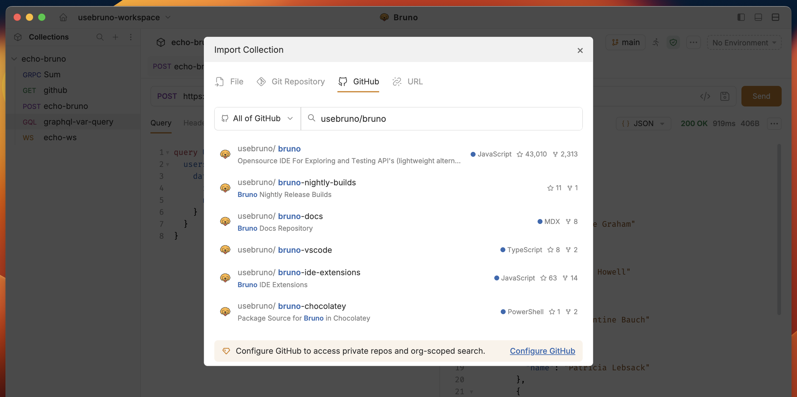

GitHub is one of the most widely used Git hosting platforms for teams and open-source projects. It gives you repositories, pull requests, issues, and Actions in one place. Bruno collections stored alongside your code stay versioned with the same workflow your team already uses.

Bruno's Git functionality works with GitHub the same way it works with other Git hosts. You can manage, collaborate on, and maintain API collections in a GitHub repository.

You can set things up from the GitHub website, or use the [GitHub CLI (`gh`)](https://cli.github.com/) if you prefer the terminal. Both paths are covered below.

## Configure GitHub

You need to set up an SSH key with GitHub. While you can also use a personal access token over HTTPS, that usually means entering credentials on every operation. SSH is a more convenient and secure way to work with GitHub.

### Create a repository on GitHub

To get started, create a repository on GitHub:

1. Log into your GitHub account (create one if you don't have one).
2. Click the **+** button in the top-right and select **New repository**.

<Frame>
  
</Frame>

3. Fill in the required fields (Repository name, Description, Visibility).
4. Click **Create repository**.

<Tip>
  You can directly create a repository on GitHub from Bruno in the Git UI. Find more details in [Create a new GitHub repository from Bruno](/git-integration/using-gui/provider#create-a-new-github-repository-from-bruno).
</Tip>

Once the repository exists, click the green **Code** button, choose **SSH** (or **HTTPS** if you prefer), and copy the URL.

<Frame>
  
</Frame>

It looks similar to:

```bash
git@github.com:<username>/<repository-name>.git
```

Or over HTTPS:

```bash
https://github.com/<username>/<repository-name>.git
```

### Configure SSH key

Follow these steps to configure an SSH key on your local system:

#### 1. Generate SSH key

Open your terminal and execute:

```bash
ssh-keygen -t ed25519 -C "your_email@example.com" -f ~/.ssh/id_ed25519_github
```

#### 2. Add SSH key to SSH agent

Add the SSH key to your SSH agent so it can be used for authentication:

```bash
ssh-add ~/.ssh/id_ed25519_github
```

#### 3. Add the SSH key to your GitHub account

1. Go to **GitHub** → **Settings** (click your avatar) → **SSH and GPG keys**.
2. Click **New SSH key**.
3. Give your key a title (for example, "Bruno Development").
4. Paste your `id_ed25519_github.pub` content.
5. Click **Add SSH key**.

<Frame>
  
</Frame>

## Use GitHub with Bruno

1. Create a Collection inside Bruno (if you haven't already).
2. Click on the **Initialize Git** button from top-right corner and **Initialize collection**.
3. Click on **Add Remote** link from the panel that appears.
4. Add **origin** (can be any name) as the name of the remote and paste your repository URL (copied previously).

<Frame>
  
</Frame>

Now you can perform push, pull, and other Git operations directly from Bruno.

For more Git operations in Bruno, see the [Collaboration via GUI documentation](/git-integration/using-gui/intro).

## Use the GitHub CLI (`gh`)

The [GitHub CLI](https://cli.github.com/) lets you create repositories, authenticate, and clone from the terminal. That is often faster than switching between the browser and Bruno, and it is the same CLI Bruno can use under **Preferences** → **Git Providers** → **GitHub**.

### Install and sign in

**macOS (Homebrew):**

```bash
brew install gh
```

**Windows (winget):**

```bash
winget install --id GitHub.cli
```

**Linux:** see the [GitHub CLI installation guide](https://github.com/cli/cli#installation).

Sign in (browser or token):

```bash
gh auth login
```

Follow the prompts to pick GitHub.com or GitHub Enterprise, HTTPS or SSH, and complete authentication. Check status with:

```bash
gh auth status
```

After successful authentication, you should see the following output on browser:
<Frame>
  
</Frame>

### Create a repository with `gh`

`gh repo create --source=.` needs an existing Git repository. Initialize the collection first, then create the remote.

1. In Bruno, open the collection and click **Initialize Git** or initialize the collection from the collection folder in a terminal:

```bash
cd /path/to/your-collection
git init
```

2. Create the GitHub repo and set `origin` from that folder:

```bash
gh repo create my-bruno-collection --private --source=. --remote=origin
```

On success, `gh` prints something like:

```text
Created repository </username>/my-bruno-collection on github.com
  https://github.com/<username>/my-bruno-collection
✓ Added remote https://github.com/<username>/my-bruno-collection.git
```

3. In Bruno, open Git UI and click on **Add Remote** button, set the name to `origin`, and paste the remote URL from the output (for example `https://github.com/<username>/my-bruno-collection.git`).

Useful flags:

- `--public` or `--private` — visibility
- `--source=.` — use the current directory as the repo root (requires `git init` first)
- `--remote=origin` — adds the GitHub repo as a local Git remote named `origin`
- `--push` — push existing commits after create

### Import a collection with GitHub provider

Import your existing collections from GitHub by connecting **GitHub CLI** in Bruno.

1. In Bruno, go to **Preferences** → **Git providers** → **GitHub**.
2. Open the **GitHub CLI** tab, install `gh` if needed, and authenticate.

<Frame>
  
</Frame>

3. Go to import dialog in Bruno and navigate to **GitHub** tab.
4. Search for the repository (use the scope dropdown for **your user** or an **organization** for private repos).
5. Click **Clone**, select the Bruno collections in that repo, and open them.

<Frame>
  
</Frame>

For PAT setup, org-scoped search, and Enterprise API URL details, see the [GitHub provider](/git-providers/github) guide.

### Push and pull after Bruno commits

If you prefer the terminal for network operations after committing in Bruno's Git UI:

```bash
git push -u origin main
git pull
```

With `gh` authenticated over HTTPS, Git uses that login for `git push` / `git pull` without pasting a PAT each time.


