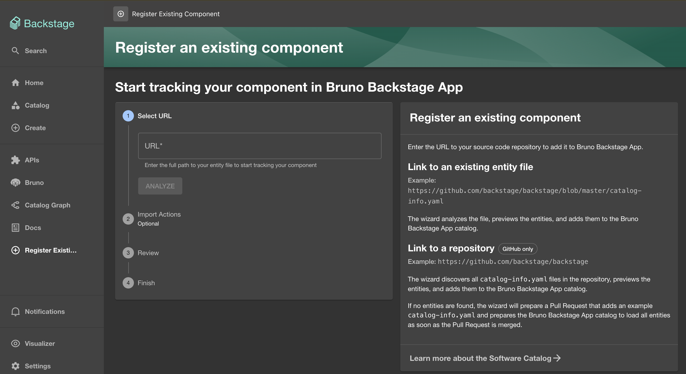

You can register a collection in three ways. Prefer Git-reviewed paths for production catalogs.

| Path | Who | How | Reviewed in Git |
|---|---|---|---|
| **`catalog-info.yaml` (recommended)** | Collection producer | Commit a `kind: Bruno` descriptor and register the location | Yes |
| **`app-config.yaml`** | Platform team | Add an entry under `bruno.collections` | Yes (Backstage repo) |
| **Wizard → Create Pull Request (default)** | Anyone signed in | Wizard generates the descriptor, opens a PR with the user's SCM token, registers the location after merge | Yes |
| **Wizard → Add directly** | Users with `bruno.collection.create` when `bruno.allowRuntimeWrites: true` | Stored in this Backstage instance's database; appears within seconds | No |

## Entity model

Every registered collection becomes a catalog entity like this:

```yaml
apiVersion: usebruno.com/v1alpha1
kind: Bruno
metadata:
  name: payments-collection # required (Backstage entity name rules)
  title: Payments API # optional; else from the collection manifest
  description: ... # optional; else from the manifest
  version: 1.2.0 # optional; else from the manifest
spec:
  type: collection # required
  url: https://github.com/acme/apis/tree/main/collections/payments
  owner: group:default/team-payments
  partOf:
    - api:default/payments-api
```

### Field notes

- **`spec.url`** points at the folder that holds `bruno.json` or `opencollection.yml`. For URL-based locations it defaults to the folder containing `catalog-info.yaml` if omitted. It is required for file locations.
- **`spec.partOf`** links the collection to zero, one, or many APIs (default kind `API`). The catalog emits `partOf` / `hasPart` relations.
- **`spec.owner`** links ownership (default kind `Group`).

The plugin generates (and overwrites if authored):

- `spec.definition` — full OpenCollection YAML (same pattern as `kind: API` storing OpenAPI)
- `spec.requestCount`
- `metadata.title`, `description`, and `version` when you did not set them

If a collection cannot be read or parsed, it is still ingested without a definition. The API Docs tab explains why. A later failed read keeps the last good definition.

## Path 1: catalog-info.yaml (recommended)

Commit a descriptor next to (or pointing at) your collection, then register the location via `catalog.locations`, a Location entity, or the catalog import page.

```yaml
apiVersion: usebruno.com/v1alpha1
kind: Bruno
metadata:
  name: payments-collection
  title: Payments API
spec:
  type: collection
  url: https://github.com/acme/apis/tree/main/collections/payments
  owner: group:default/team-payments
  partOf:
    - api:default/payments-api
```

Do not set `spec.definition` or `spec.requestCount` by hand.

## Path 2: app-config.yaml

Useful when the platform team owns registration centrally:

```yaml
bruno:
  allowRuntimeWrites: false
  collections:
    - type: url
      name: payments
      url: https://github.com/acme/apis/tree/main/collections/payments
      owner: group:default/team-payments
      partOf: [api:default/payments-api]
```

An `app-config.yaml` entry always wins over a UI-added collection with the same name.

## Path 3: Add Bruno Collection wizard

Open **Bruno** in the sidebar → **Add Bruno Collection** (`/bruno/add`).

1. **Collection URL** — Paste the folder URL and click **Analyze**. The backend checks for `bruno.json` or `opencollection.yml` and shows name, format, manifest path, version, and description.
2. **Describe the collection** — Entity name (prefilled), display title (prefilled), **Part of** (API search), and **Owner** (user/group search, required).
3. **Choose how to register** — Shown only when direct add is allowed for this user.
4. **Review** — PR title/body with descriptor preview, or entity summary for a direct add.
5. **Done** — Links to the PR or the new entity.
 
 

### Pull request vs direct add

- **Create Pull Request** is the default. GitHub only in Beta; other hosts get a **Download** button for the descriptor.
- **Add directly to catalog** requires `bruno.allowRuntimeWrites: true` and `bruno.collection.create`. The collection can later be edited or deleted from the entity page (UI-added only).

PRs are opened from the browser with the user's own SCM token (`scmAuthApi`). The token is never sent to the plugin backend.

### Conflict rules

- Names are unique per Backstage instance.
- The wizard refuses a name that already exists in the UI store, in config, or in the catalog.
- UI-added collections are edited or deleted only from the UI. Config and descriptor collections change in their source file.

## After registration

On the Bruno entity:

- Use **Open Collection** to hand off to Bruno desktop
- Open the **API Docs** tab for the in-portal docs view
- See **Associated APIs** for linked API entities

On each linked API entity, the **Bruno Collections** card lists collections that declare `partOf` that API.

## URL formats

| Host | Folder URL shape |
|---|---|
| GitHub / GitHub Enterprise | `/<owner>/<repo>/tree/<ref>/<path>` |
| GitLab | `/<group>/.../<project>/-/tree/<ref>/<path>` |
| Bitbucket Cloud | `/<workspace>/<repo>/src/<ref>/<path>` |

Branch names containing `/` are not supported in Beta.

See [Configuration](./configuration) for supported hosts, permissions, and security details.
