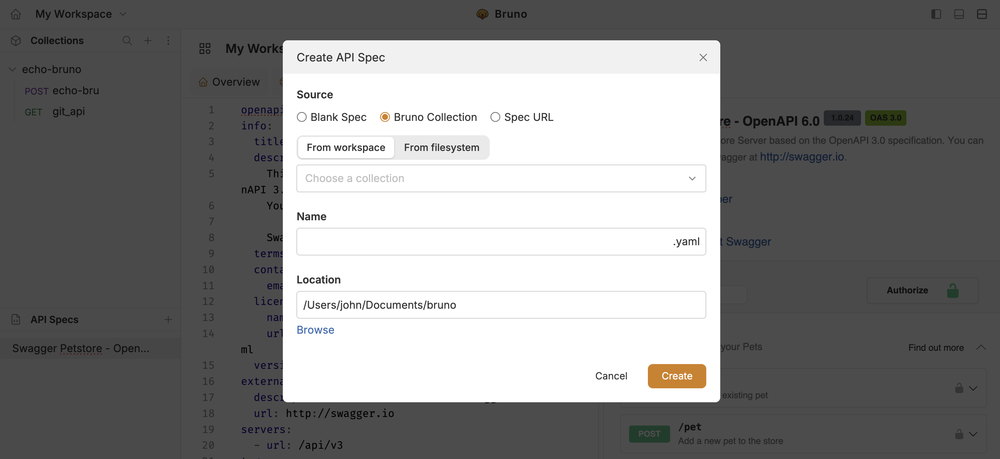
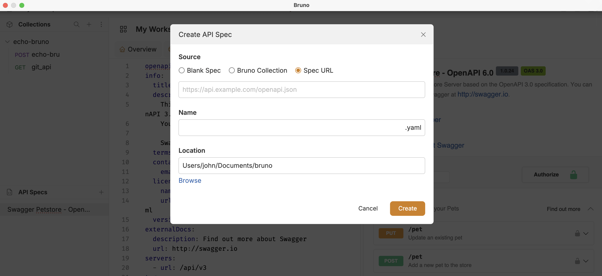

Bruno can open an existing OpenAPI Specification (OAS) and create a new one. A new spec can start blank, be generated from a Bruno collection, or be fetched from a URL hosting an OpenAPI spec.

## Viewing Existing OAS Files

You can view and interact with existing OAS files in Bruno using a SwaggerUI-like interface:

1. Enable OpenAPI Spec feature from **Preferences** to start working with it.

2. Select **Open API Spec** from dropdown in left hand side menu.  

3. Browse and select your OAS file (`.yaml` or `.json`)
4. The specification will open in a dedicated section of your Bruno sidebar

## Creating New OAS Files

1. Select **Create API Spec** from the dropdown (or click **+** next to **API Specs** in the sidebar).

2. In the **Create API Spec** modal, choose a **Source**:
   - **Blank Spec**: Start from an empty specification.
   - **From Bruno Collection**: Generate the spec from an existing collection. Select **From workspace** to pick a collection in the current workspace, or **From file system** to browse to a collection folder that contains a `bruno.json` or `opencollection.yml`. If the collection has environments, select the environment whose variables Bruno uses in the spec.
   - **From Spec URL**: Enter an `http` or `https` URL to a hosted spec. Bruno only accepts OpenAPI 3.x specifications and rejects Swagger 2.0. Bruno saves the file in the format the URL serves, so JSON stays `.json` and YAML stays `.yaml`.

3. Enter a **Name** and **Location** for your specification. Bruno prefills the name from the collection name or the spec title, and prefills the location with the workspace's default API spec folder (a named workspace uses its `apispec` folder; the default workspace uses the location from **Preferences**, or that workspace's `apispec` folder when no default is set). Click **Browse** to choose a different folder.

4. Click **Create** to generate the OAS file.

### Spec URL

Select **Spec URL** and enter an `http` or `https` URL that returns an OpenAPI 3.x document (YAML or JSON). Bruno fetches the URL and checks that it is an OpenAPI 3.x specification. Swagger 2.0 is rejected. **Name** is filled from the spec's `info.title`. The saved file is `.json` when the response is JSON, and `.yaml` otherwise.

## Editing Your OAS File

Once created, you can edit your OAS file in Bruno's built-in editor:

1. The editor provides syntax highlighting
2. Use the sidebar to navigate through different sections of your API
3. Add or modify endpoints, parameters, and responses
4. Include examples and descriptions for better documentation

### Working with API spec tabs

Each API spec you open from the sidebar opens in its own tab, next to your other workspace tabs. You can keep several specs open and switch between them.

- Press `Cmd+S` (macOS) or `Ctrl+S` (Windows/Linux) to save your changes.
- If you close a tab with unsaved changes, Bruno asks whether to save or discard them.
- Bruno restores your open API spec tabs when you reopen or switch back to the workspace.
