OpenAPI Sync keeps your Bruno collection aligned with an OpenAPI/Swagger spec. Connect a workspace API Spec, a remote URL, or a local file. It tracks changes locally, removes the manual effort of re-importing when the spec changes, and helps teams stay in sync.

<iframe src="https://www.youtube.com/embed/5255Cx5pLn4" title="YouTube video player" frameborder="0" className="w-full aspect-video rounded-xl" allow="accelerometer; autoplay; clipboard-write; encrypted-media; gyroscope; picture-in-picture; web-share" allowfullscreen />

<Info>
  Open Source edition allows **5 syncs per month**. For unlimited syncs, you need [Bruno Pro or Ultimate](https://www.usebruno.com/pricing).
</Info>

## Connect to OpenAPI Sync

There are two ways to connect to OpenAPI Sync:

1. [Existing Collection](#existing-collection)
2. [New Import](#new-import)

### Existing Collection

1. Open the collection context menu (right-click the collection, or use **`···`** in the collection header).
2. Select **OpenAPI**.

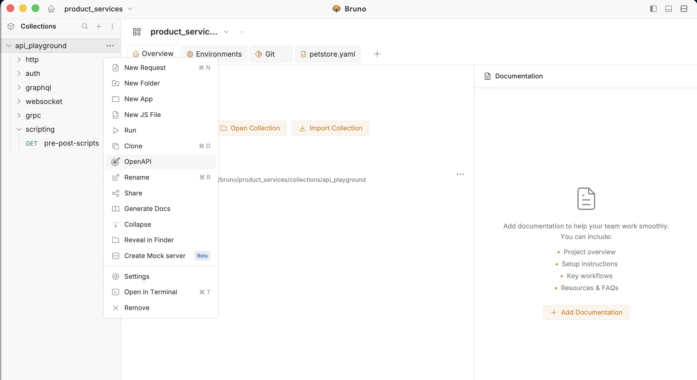

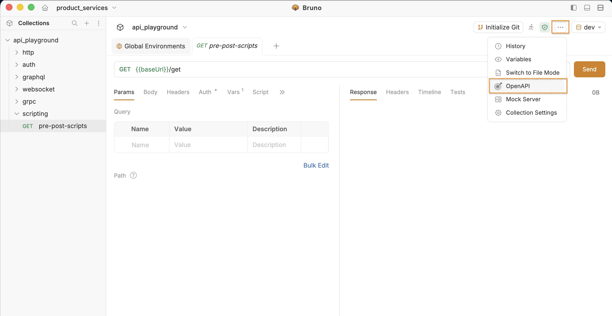

3. Choose a **Spec Source**:
   - **Workspace** – Pick an API Spec already listed under **API Specs** in the sidebar. Nothing is auto-selected. If the workspace has no specs, the list says so. Browse remains available on the **File** tab for specs outside the workspace.
   - **URL** – Enter a remote OpenAPI spec URL.
   - **File** – Browse to an OpenAPI file on disk.

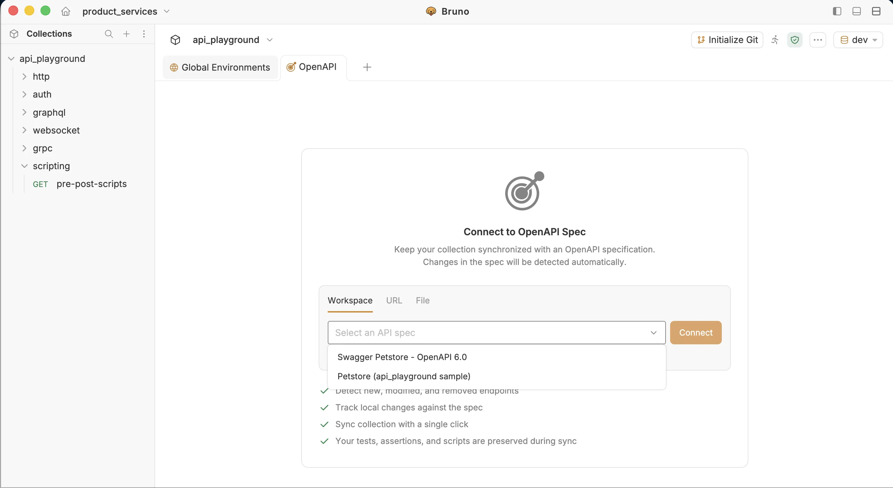

4. Click **Connect**.

A workspace pick is stored as a path relative to the collection, so the committed sync config stays portable for teammates with the same workspace. Absolute paths from earlier connections keep working. Sync behavior (drift detection, auto-check, and the sync action) is the same for every source.

### New Import

1. Import a collection from an OpenAPI spec file or URL. Set **Folder Arrangement**, and in **Advanced** set **Naming requests** and optionally **Inherit authentication from collection folder** if you want something other than the defaults.

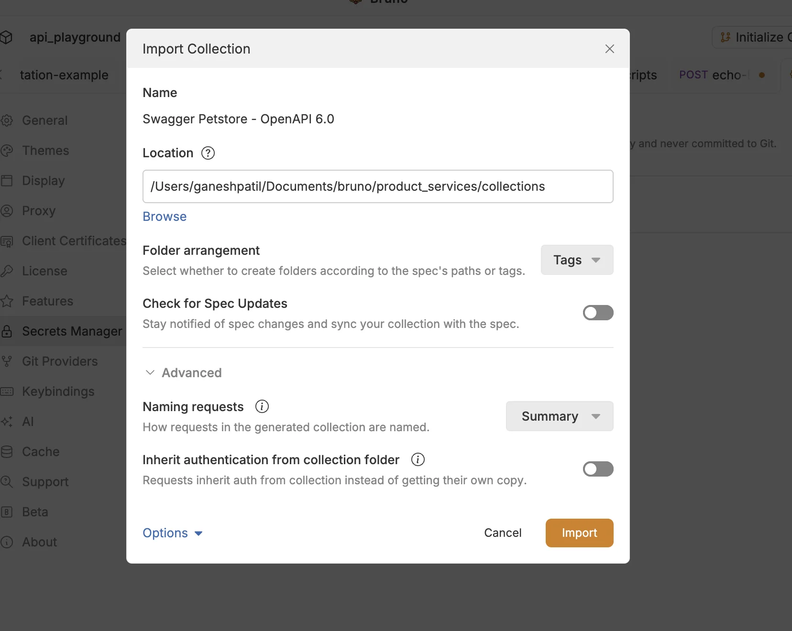

2. Enable **Check for Spec Updates** to connect OpenAPI Sync on import.

<Info>
  When sync is enabled, Bruno saves your **Naming requests** choice as `requestNameSource` and **Inherit authentication from collection folder** as `authPlacement` (`request` or `collection`) in the collection OpenAPI sync config (alongside folder grouping). Later syncs reuse those choices. With `authPlacement: collection`, re-sync does not overwrite collection auth, and inheriting requests stay on inherit. See [Import an OpenAPI Spec](/open-api/importOAS#import-settings).
</Info>

If you have the same endpoints in your OpenAPI spec and collection, you don't need to sync. If the endpoints don't match, then you have to perform **Initial Sync** changes with the collection.

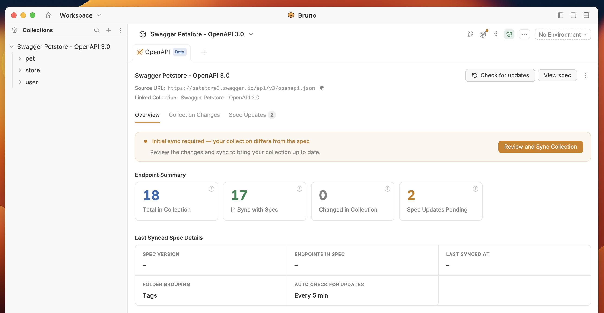

## OpenAPI Sync UI at a glance

The UI shows a summary of sync status:

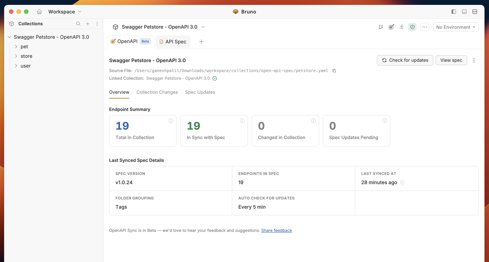

### 1. Overview

Your dashboard: summary of sync status, pending spec updates, and local collection changes. Shows **last synced** time and **spec version** (or title) so you know which spec version the collection is based on.

| Term | Meaning |
| --- | --- |
| **Total in Collection** | Total number of endpoints in your collection. |
| **In Sync with Spec** | Endpoints where your local collection matches the OpenAPI spec. |
| **Changed in Collection** | Changes you made locally in Bruno (URL, params, headers, body, etc.). |
| **Spec Updated Pending** | Changes from the remote spec that are not yet applied locally. |

### 2. Collection Changes

Shows **your local collection changes** in Bruno:

- **Deleted** – Endpoints or fields removed in your collection.
- **Added** – Endpoints or fields added in your collection.
- **Modified** – Endpoints or fields modified in your collection.

Only **body, URL, params, and headers** are tracked here. Tests, scripts, assertions, and request settings are not tracked.

Auth config differences within the same auth mode (for example, changing an OAuth2 scope or token value) are not treated as drift. Only a change in auth mode is tracked as a modification. This means preserved auth values will not keep your collection in a permanent out-of-sync state.

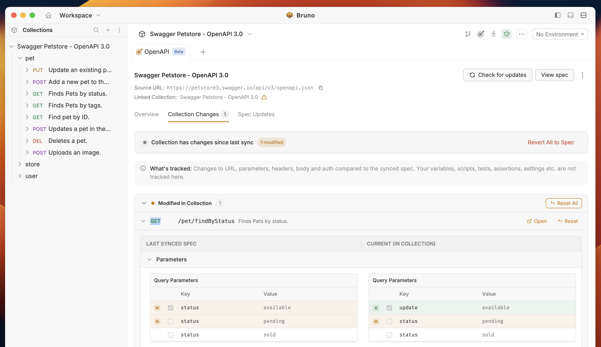

### 3. Spec Updated

Shows when the **remote spec has been updated** and changes are pending. You can:

- **Sync collection** – Apply the remote spec changes to your local collection
- **Skip All** – Skip all the changes and continue with your local collection
- **Accept All** – Accept all the changes
- **Keep Current** – Keep the current changes

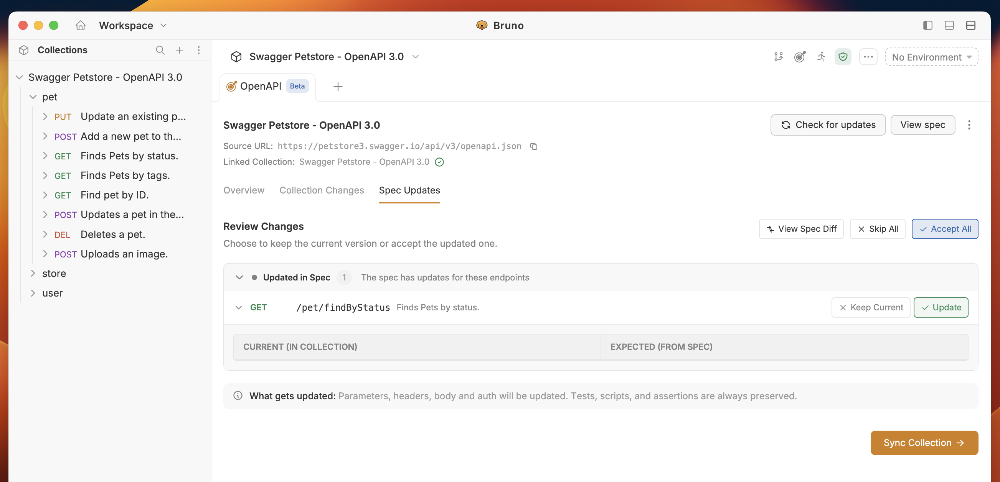

Click **Confirm and Sync Collection** to apply the remote spec changes to your local collection.

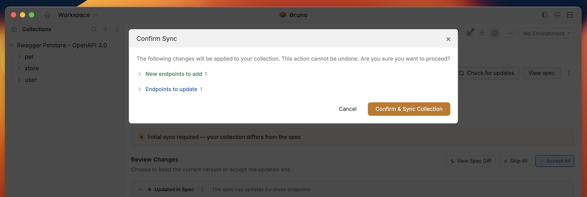

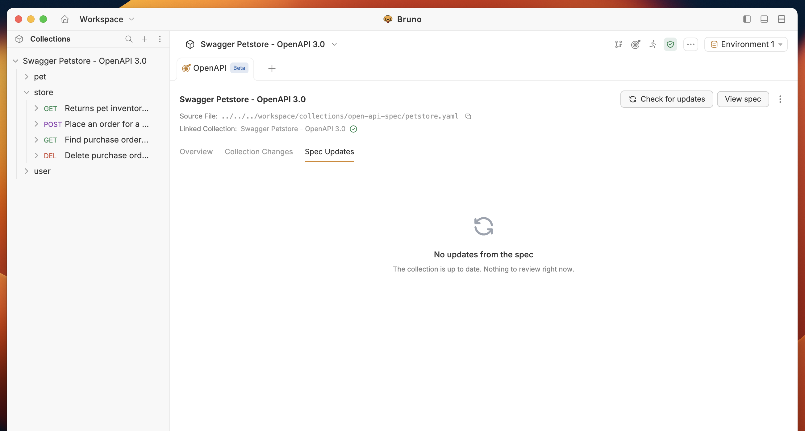

<Info>
  When you and the spec both changed the same field, Bruno keeps your value by default and surfaces the difference in the per-endpoint review so you can decide what to keep.
</Info>

## Sync vs Reset

OpenAPI Sync offers two ways to apply spec changes, each serving a different purpose.

### Sync

Sync reconciles your collection structure with the spec while keeping the values you have entered. It does not overwrite your work.

**JSON body**

Fields that still exist in the spec keep your values. Fields the spec adds are inserted with the spec's example or default value. Fields the spec removes are dropped. Variable references like `{{baseUrl}}` or `{{token}}` are preserved exactly as written.

**Params and headers**

Entries that still exist in the spec keep your value and enabled state. New spec entries are added. Entries the spec drops are removed.

**Form bodies** (URL-encoded and multipart)

Same rule as params, keyed on field name.

**Auth**

When your request and the spec share the same auth mode, all auth field values are preserved including OAuth2 URLs, scopes, grant type, API key placement, client credentials, and any variable references. Bruno does not overwrite these.

When the auth mode differs, the auth fields update to match the new mode and the difference is surfaced as a modification in the review screen.

### Reset

Reset is a per-endpoint action available on requests that have drifted from the spec. It replaces the spec-derived fields (URL, params, headers, body, auth) with the spec's version. Your tests, scripts, and assertions are always kept.

Use Reset when you want to deliberately discard local changes to a request and start fresh from the spec.

## What the diff preview shows

The Spec Updates tab shows what your collection will look like after sync, not the raw spec. Fields you have already set to the correct value do not appear as changes. Only structural additions, removals, and auth mode differences are shown. This means reviewing a sync is straightforward: if a field appears in the diff, something actually changed.

## What gets preserved across both Sync and Reset

- Pre-request scripts
- Post-response scripts
- Tests and assertions
- Request settings

The latest spec is also saved locally under `collection/resources/spec/` so sync works offline.

## Connection Settings

OpenAPI Sync checks for spec updates automatically **every 5 minutes**. You can control this setting as follows:

1. Click the context menu (**`···`**) next to **View spec**.

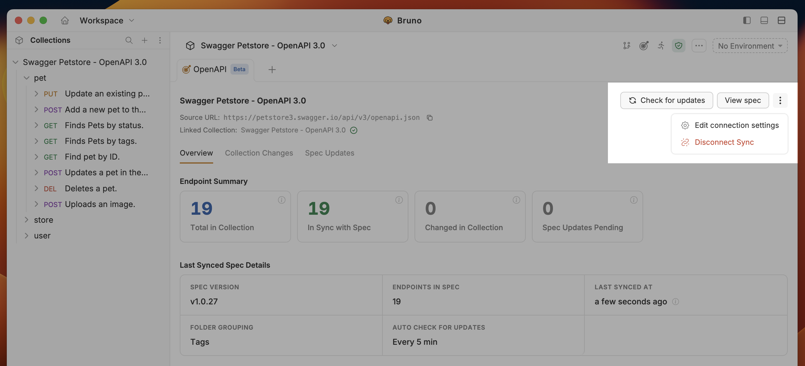

2. Select **Edit connection settings**.

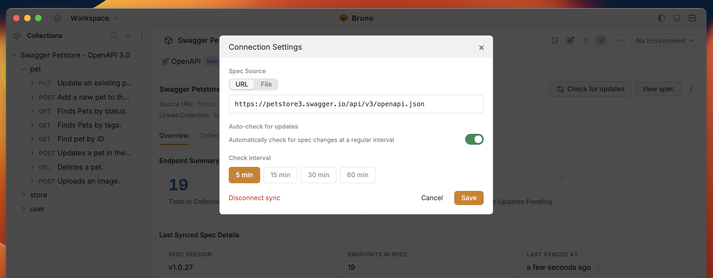

In Connection Settings you can:

- Change the **Spec Source** the same way as Connect (**Workspace**, **URL**, or **File**). A collection connected to a workspace spec shows that spec as selected, not only a bare filename.
- Enable or disable automatic checks
- Disconnect sync
- Adjust when Bruno looks for spec updates

## Inspect Spec

To view and inspect the OpenAPI spec:

1. Click **View spec** on the top right-hand side of the OpenAPI Sync UI.

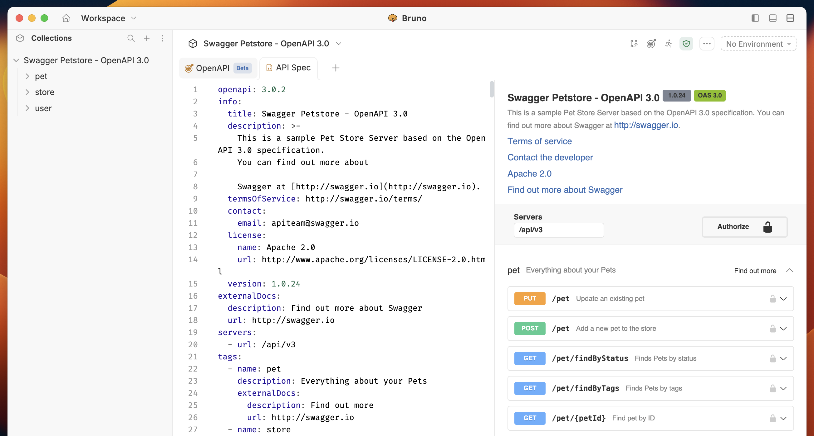

Its **read only** SwaggerUI-like interface to the OpenAPI spec.

Please share your feedback or report issues [here](https://github.com/usebruno/bruno/discussions/7401).

## Resources

- [Blog - How to Sync API Collections with OpenAPI Specifications Using Bruno OpenAPI Sync](https://blog.usebruno.com/keep-your-api-collections-in-sync-with-openapi-sync)