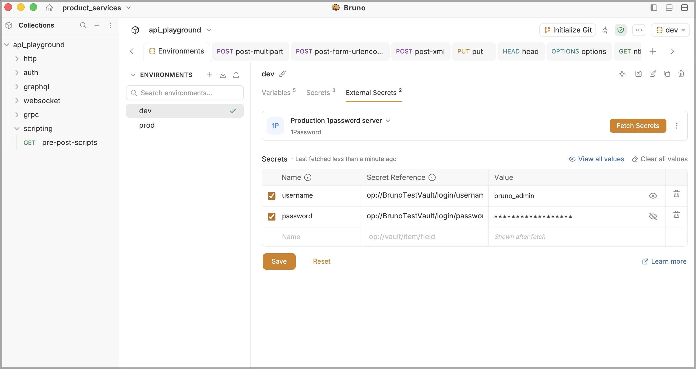
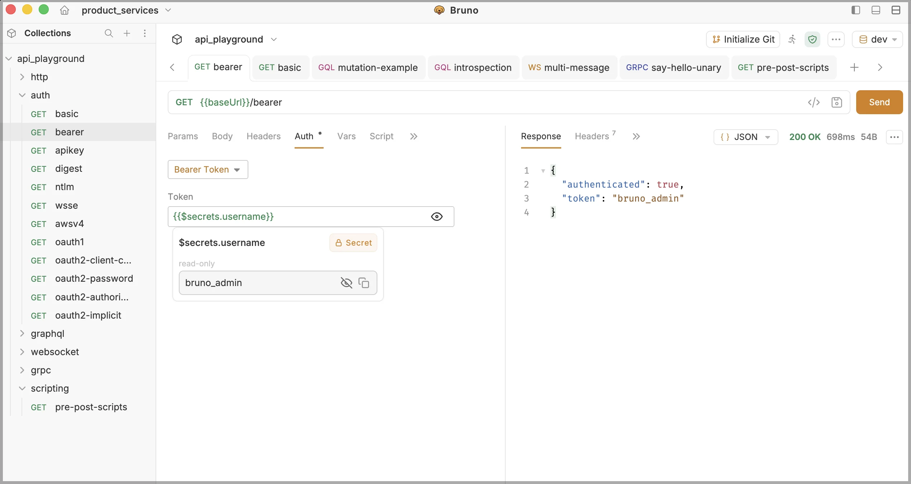

After you fetch 1Password secrets into an environment, reference resolved values in requests as `{{name}}` or `{{$secrets.name}}`. Both work in headers, query params, body, and auth fields.

## Variable syntax

Each **Name** you configured under External Secrets is the variable you use in requests.

```

```
### Legacy syntax
```
{{$secrets.<name>}}
```
<Note>
  `{{$secrets.name}}` is the legacy syntax and still works, but it will be removed in the next major release. `{{name}}` is the preferred syntax for all new requests.
</Note>

## Using secrets in API requests

For example, with a row named `username` pointing at `op://BrunoTestVault/login/username`:




```
{{username}} // recommended
{{$secrets.username}} // legacy
```



## Using secrets in scripts

Access secrets from Pre-request and Post-response scripts with `bru.getSecretVar()`:

```javascript
const username = bru.getSecretVar('username');
req.setHeader('X-User', username);
```

Make sure the 1Password account is configured and secrets are fetched (or will be fetched on demand) before using them in scripts. Names must match the environment rows exactly.

## Using secrets with Bruno CLI

Supply the Service Account token with `--secrets-env-file`. The environment file already holds the `op://` references; the CLI resolves them at run time.

```bash
bru run collection/ --env local --secrets-env-file ./secrets.env
```

Example `secrets.env`:

```bash
BRUNO_ONE_PASSWORD_SERVICE_ACCOUNT_TOKEN=ops_...
```

You can export this file from **Preferences** > **Secrets Manager** (see [Integrating 1Password](./adding-a-secret-provider#exporting-as-a-env-file)).

For the full CLI reference across providers, see [Secret Managers using CLI](/bru-cli/secret-managers).
