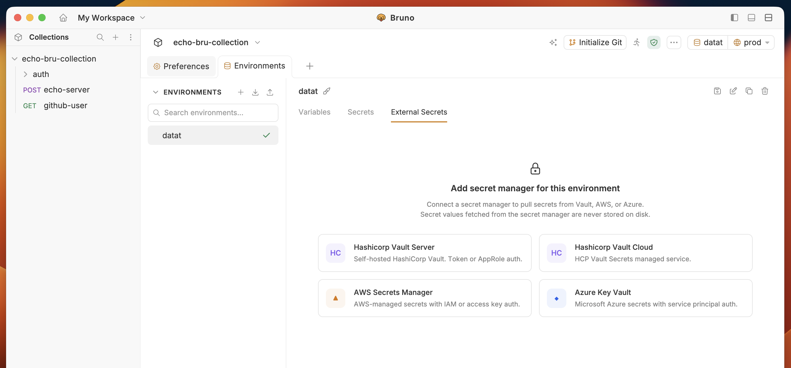
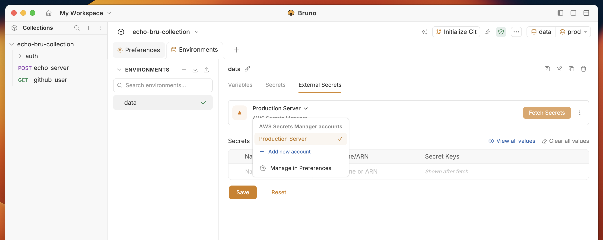
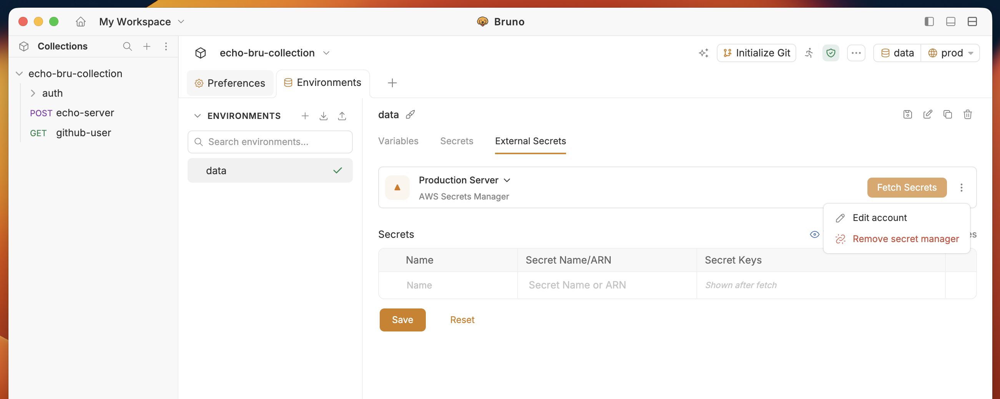

<Note>
  Starting from Bruno v4.0.0, secret manager configuration has moved from **Collection > Secrets** to **Environment > External Secrets**.
</Note>

<Info>
  **Fetching and storage**

  - **Fetch Secrets** (or the first request that needs them) loads values into memory for that environment only.
  - Secret values are **never saved on your machine**. Bruno only keeps provider settings and secret names.
  - Closing Bruno or the collection clears the cache. Reopen the app and Bruno fetches secrets again when you need them.
</Info>

1. Go to **Environment** > **External Secrets** and select **AWS Secrets Manager** 

2. You will see the configured **Secret Manager** accounts list from **Preferences** settings. Select the **AWS Secrets Manager** account you want to use.

- Use **Add new account** to create an account, or pick one you already added in Preferences. For CLI profiles, see [AWS CLI Authentication](./aws-cli-authentication).

3. Enter a **Name** and the **AWS Secret Name or ARN** for the secret you want to fetch.

   - **Name** - the alias used to reference the secret in Bruno, e.g. `apiCredentials`
   - **AWS Secret Name / ARN** - the exact secret name or full ARN, e.g. `prod/api-key` or `arn:aws:secretsmanager:us-east-1:123456789012:secret:prod/api-key`

4. Click the **Fetch Secrets** button in the top-right corner.

5. Fetched secret keys appear under **Secret Keys**. Values stay in memory for the session only and are never saved on your machine.

Use three dots menu to:
- **Edit account** to edit the account details
- **Remove secret manager** to remove the secret manager configuration

