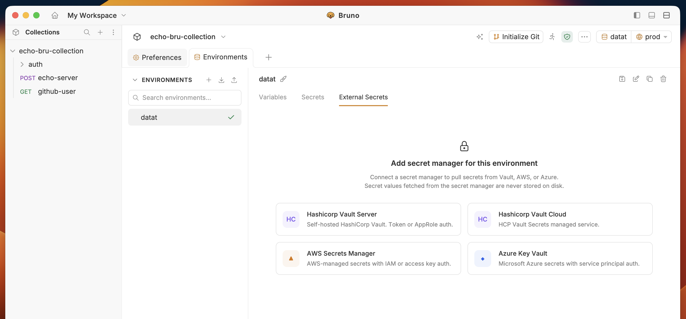
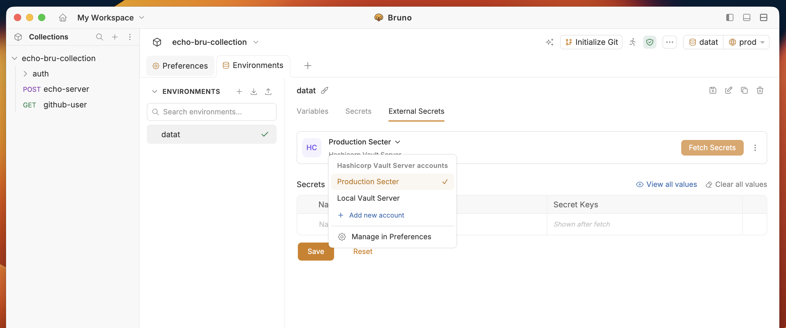
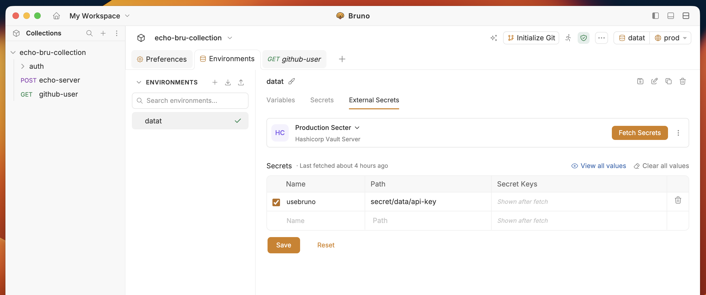
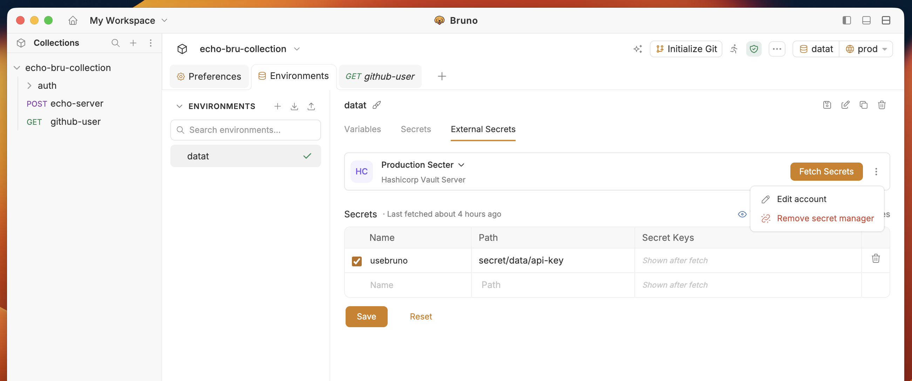

<Note>
    Starting from Bruno v4.0.0, the configuration of secret managers has moved from **Collection > Secrets** to **Environment > External Secrets** tab.
</Note>

<Info>
  **Fetching and storage**

  - **Fetch Secrets** (or the first request that needs them) loads values into memory for that environment only.
  - Secret values are **never saved on your machine**. Bruno only keeps provider settings and secret names.
  - Closing Bruno or the collection clears the cache. Reopen the app and Bruno fetches secrets again when you need them.
</Info>

1. Go to **Environment** > **External Secrets** and select the secret manager you want to configure.

2. You will see the configured **Secret Manager** accounts list from **Preferences** settings. Select the **Account** you want to configure.

3. Enter **Name** and **Path** for the secret you want to fetch.

- **Name** — the name you will use to reference the secret in Bruno, e.g. `usebruno`
- **Path** — the Vault API path of the secret, without the leading `/v1/`. Bruno sends this path to Vault as-is, so it must begin with the mount path of your KV secrets engine. The default mount is `secret/`, but your Vault admin may have mounted the engine anywhere, e.g. `kv/` or `team-a/`.
  - **KV v2** engines (the default in Vault dev mode): include the `data/` segment, `<mount>/data/<secret-path>`, e.g. `secret/data/api-key`
  - **KV v1** engines: no `data/` segment, `<mount>/<secret-path>`, e.g. `secret/api-key`

<Tip>
  Not sure of your mount path or KV version? Run `vault secrets list -detailed` to see mounts and their `version` option, or `vault kv get -output-curl-string <mount>/<secret-path>` to print the exact API path Vault expects. Use that path minus the `/v1/` prefix.
</Tip>

4. Click on the `Fetch Secrets` button on the top right corner.

5. Fetched secret keys appear under **Secret Keys**. Values stay in memory for the session only and are never saved on your machine.

Use three dots menu to:

- **Edit account** to edit the account details
- **Remove secret manager** to remove the secret manager configuration

