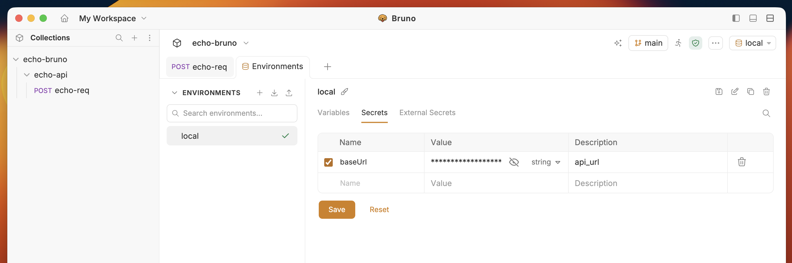
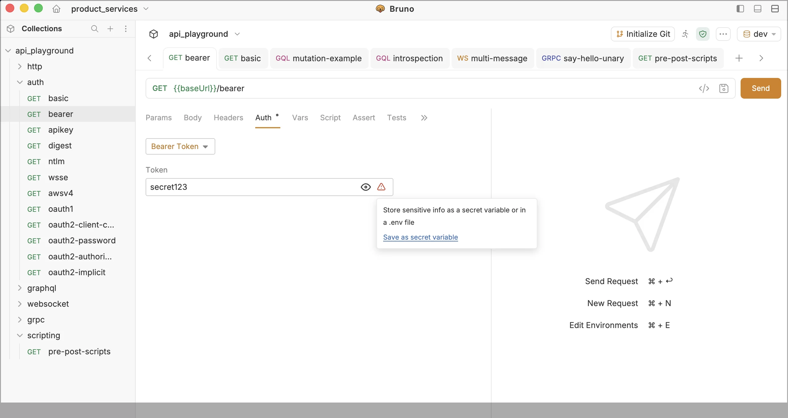
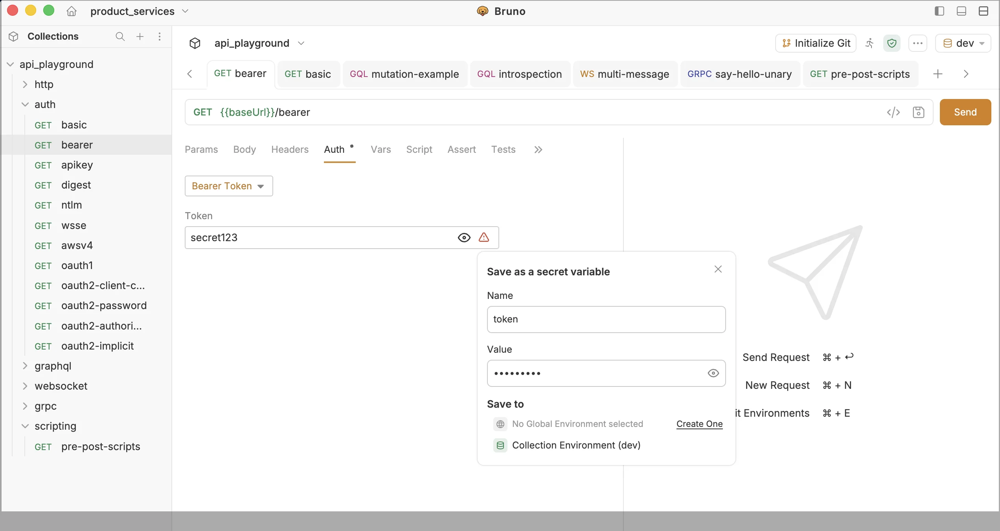

<Tip>
Bruno stores secrets on your local machine. The location depends on the OS.
The secrets are encrypted using OS level encryption when available or falls back to AES256 encryption.
</Tip>

Secret variables store sensitive information such as API keys, passwords, and tokens. Mark a variable as secret with the `secret` checkbox in your environment, or manage them from the **Secrets** tab on a specific environment. Bruno keeps the values internally and does not write them into the environment file.

Your environment file stores only the secret **name** (and optional metadata). The secret **value** stays in Bruno's local encrypted store, not in the file.

<Warning>
Starting from v4.0.0, all secret variables are displayed in a separate tab to avoid confusion between normal and secret vars. Secret values are stored securely and are not saved to the environment file.
</Warning>




<Tabs>
  <Tab title="OpenCollection YAML">
```yaml environments/local.yml
name: local
variables:
  - secret: true
    name: baseUrl
    description: "api_url"
```
  </Tab>
  <Tab title="Bru">
```bru environments/local.bru
vars:secret [
  baseUrl
]
```
  </Tab>
</Tabs>

## How to use secret variables in requests

Use a secret variable like any other environment variable. Reference it with `{{variable}}` in the request URL, params, headers, body, auth, and other fields. Bruno resolves it to the secret value when the request runs.

For example, with a secret named `apiKey`:

```
Authorization: Bearer {{apiKey}}
```

## What Bruno does not store or export

- **Environment files:** Only the secret **name** is written. The value stays in Bruno's local encrypted store and never appears in `environments/*.yml` or `environments/*.yml`.
- **Collection export:** Secret values are not included when you export a collection.
- **Generated documentation:** Secret values are not exported with your docs.
- **Test reports:** Secret values are masked as `****` in reports.

You can safely commit the collection to source control without exposing secret values.

## Using secret variables with Bruno CLI

Because secret values are not persisted for the CLI, pass them explicitly when you run with an active environment:

```bash
bru run --env Local --env-var apiKey=your-secret-value
```

Repeat `--env-var` for each secret. See [Passing environment variables](/bru-cli/run/overview#passing-environment-variables) in the Bruno CLI docs.

## Sensitive field warnings

Bruno shows a warning when a sensitive field sends a value that is stored in plain text. Sensitive fields include:

- Auth secrets, such as passwords, bearer tokens, API key values, OAuth 2.0 client secrets, OAuth 1.0 consumer and token secrets, AWS Signature v4 secret keys and session tokens, and Akamai EdgeGrid tokens and secrets
- The collection proxy password
- Client certificate passphrases



Bruno resolves each `{{variable}}` in the field using the normal [variable precedence](/variables/overview), including auth inherited from a folder or collection. Bruno then warns in these cases:

| Field value | Warning |
| --- | --- |
| A literal value, or text outside a `{{variable}}` | Store sensitive info as a secret variable or in a .env file |
| A non-secret environment or global environment variable | Mark the environment variable as secret for better security |
| A request, folder, or collection variable | `"<name>" is a <scope> variable and is stored in plain text. Move it to an environment as a secret.` |

Bruno does not warn when the variable resolves to a secret environment variable, a secret global environment variable, a runtime variable, or a `process.env` variable.

Bruno also flags the variable row itself. In environment and global environment tables, non-secret variables used in a sensitive field show **This variable is used in sensitive fields. Add it as a secret for security**. In request, folder, and collection **Vars** tables, the row shows that the variable is used in a sensitive field and is stored in plain text.

From the warning, you can choose **Save as secret variable** to move the value into a secret on the collection or global environment.



To clear a warning, check the `secret` checkbox for the environment variable, or move the value into a [`.env` file](/secrets-management/dotenv-file) and reference it with `{{process.env.NAME}}`.
