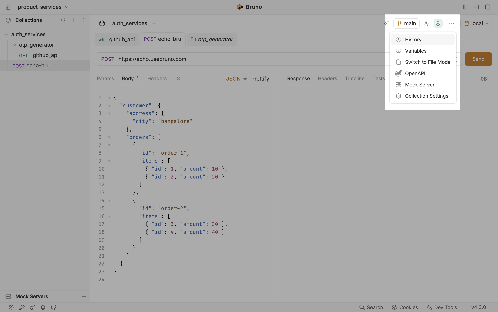
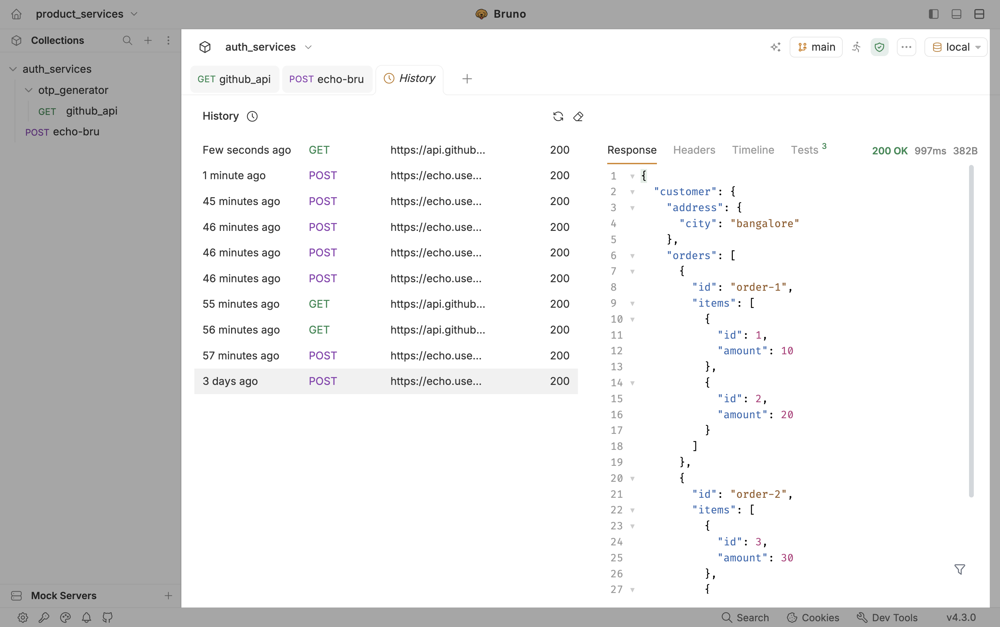

The History feature in Bruno keeps a log of requests you have sent in a collection. Use it to reopen a past call, check its status and timing, and inspect the saved response without running the request again.

## How it works

Bruno records each send for the active collection. History entries show when the request ran, the method and URL, and the status code. Selecting an entry opens its details in the right pane.

## View request history

1. Open a collection in Bruno.
2. In the collection toolbar (top right, next to the environment selector), click the `···` menu.
3. Select **History**.

4. Bruno opens a **History** tab with the request activity log for that collection.
5. Select a row in the list to inspect that run. The right pane shows **Response**, **Headers**, **Timeline**, and **Tests** for the selected entry.

### What you see in the list

| Column | Description |
| ------ | ----------- |
| **Time** | When the request was sent (for example, a few seconds ago or days ago) |
| **Method** | HTTP method (`GET`, `POST`, and so on) |
| **URL** | Request URL |
| **Status** | Response status code |

Use the refresh control to reload the list, or clear history when you want to remove past entries from this collection.
