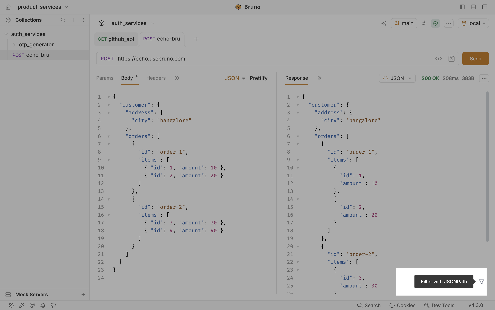
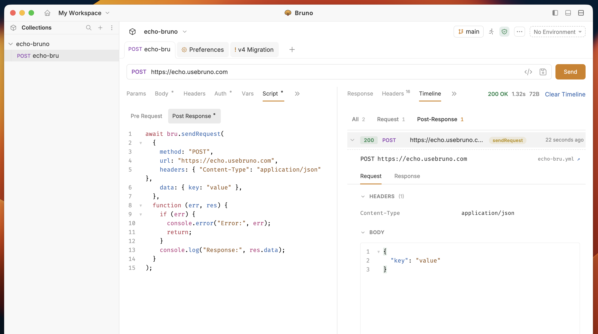

The API returns data as a response from the server after the request is executed. The response panel in Bruno provides you with an organized view of the API's response, including the body, headers, HTTP status code, raw response code, and more.

### Response Panel

After executing a request, the response panel provides detailed information on the API's response. It shows the response body, headers, status code, and other relevant data. You can also search within the response using the `cmd+f` or `ctrl+f` keyboard shortcut.


### Data Type Selector

Bruno provides a powerful response format selector that allows you to view API responses in different formats, making it easier to inspect and analyze response data. This feature includes both an **Editor** view for viewing formatted code and a **Preview** view for visualizing the response content.


### Filter with JSONPath

Large JSON responses are hard to scan by eye. **Filter with JSONPath** lets you focus the response pane on only the fields or array items you care about, without copying the body into a script or another tool.

Use it when you want to:

- Check one nested field after a send (for example a city, id, or amount)
- Confirm a list of values across nested arrays
- Debug payloads from echo or staging APIs before writing tests

Click the filter (funnel) icon at the bottom of the response pane when the body is shown as JSON. The tooltip reads **Filter with JSONPath**.



#### How to use it

1. Send a request that returns JSON.
2. In the response pane, keep the format set to **JSON**.
3. Click the filter icon and enter a [JSONPath](https://www.rfc-editor.org/info/rfc9535/) expression.
4. Bruno updates the pane to show only the matched values. Clear the filter to see the full body again.

#### Examples

These examples use the same customer payload shown in the screenshot:

```json
{
  "customer": {
    "address": {
      "city": "bangalore"
    },
    "orders": [
      {
        "id": "order-1",
        "items": [
          { "id": 1, "amount": 10 },
          { "id": 2, "amount": 20 }
        ]
      },
      {
        "id": "order-2",
        "items": [
          { "id": 3, "amount": 30 },
          { "id": 4, "amount": 40 }
        ]
      }
    ]
  }
}
```

| JSONPath | What you get |
| -------- | ------------ |
| `$.customer.address.city` | `"bangalore"` |
| `$.customer.orders[*].id` | `["order-1", "order-2"]` |
| `$.customer.orders[0].items[*].amount` | `[10, 20]` |
| `$.customer.orders[*].items[*].amount` | `[10, 20, 30, 40]` |
| `$.customer.orders[*].items[?(@.amount > 20)]` | Items with `amount` greater than `20` |
| `$.customer.orders[1].items[?(@.id == 4)].amount` | `[40]` |

<Tip>
  JSONPath in the response pane is for **inspecting** the body in the UI. To read the same fields in scripts, tests, or vars, use [Response query](/testing/script/response/response-query) (`res('customer.address.city')`).
</Tip>

### Headers

The request headers are displayed to show what was sent to the API. This can help in debugging and understanding the context of the request.


### Timeline

The **Timeline** tab lists every HTTP call from a request run along with the main request plus any calls made by scripts. See [Timeline](/debugging/timeline) for context badges (`main`, `sendRequest`, `runRequest`), filter tabs, and per-request details.



### Response Actions

Bruno provides multiple options to manage your response data, including saving as examples, downloading to files, copying, and clearing the response panel.


- **Save as Example** - Save the response as a sub-request under your main request for documenting different API behaviors and scenarios
- **Download Response** - Export the response data to a file in various formats such as HTML
- **Copy Response** - Quickly copy the response data to your clipboard for use in other applications
- **Change Layout** - Switch between different layout views to customize how the response is displayed
- **Clear Response** - Reset or clear the response data from the panel

**Learn more:** [Response Examples](/send-requests/res-data-cookies/response-examples)

